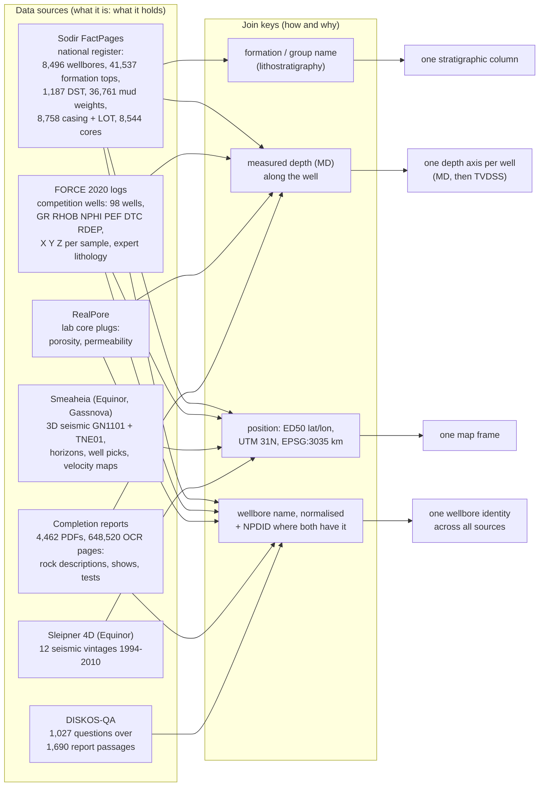
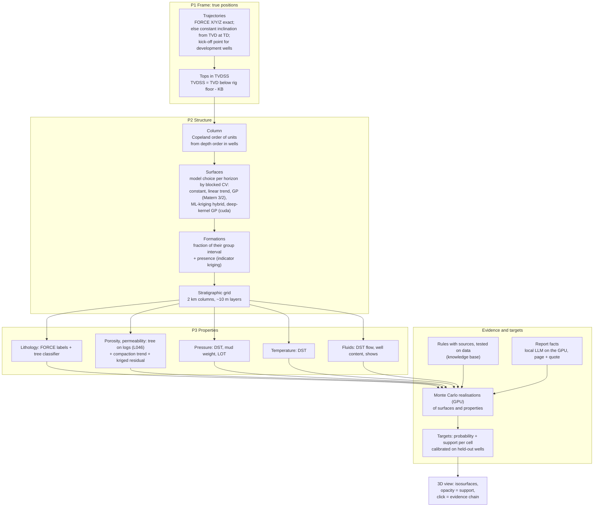

# Architecture: data, links, methods, results

How every source becomes part of the NCS earth model, and what came out (numbers measured, LOG ids in brackets). Pilot = Horda Platform / northern Viking Graben.

## 1. Data sources and how they connect

| Link | Why | How | Checked |
|---|---|---|---|
| Wellbore name | Every table names wells differently | One normaliser (`se/ingest/names.py`); NPDID where present | RealPore by NPDID and name (L051) |
| MD | Logs, cores, picks, tests and report lines all carry MD | Rows fall into a well x formation interval by MD | Feet vs metres guard by total depth (L008) |
| Position | Neighbours, maps, seismic | ED50 throughout; FORCE X/Y = ED50 UTM 31N | 6 m median vs FactPages wellheads (L055) |
| Formation name | Same unit across wells | FactPages lexicon: level and parent group | 99.89 percent of group pairs agree on order (L056) |

## 2. Methods and what they yield

## 3. Results so far, and what explains them

| Step | Input | Result | Why it came out this way |
|---|---|---|---|
| Frame (L055) | 87 FORCE wells with true paths vs FactPages-only | median depth error 0.42 m per well; 90 % intervals hold 92-94 % on held-out wells | Most exploration wells are near-vertical; the few deviated ones dominate the RMSE (p90 60-80 m) |
| Tops (L055) | 14,276 pilot tops | all converted; 642 wells pass the seabed check, 19 flagged | Datums agree: MD + Z = KB (median 0.0 m) |
| Column (L056) | 9,754 formation + 4,522 group tops | 12 groups in order, 55 horizons modelled | Viking formations interfinger (94.6 % pairwise agreement), so their order is decided per column |
| Shallow surfaces (L056) | ~450 wells per horizon | seabed 27 m, Rogaland 187 m, Shetland 210 m held-out error; beat trend by 25-58 % | Cenozoic layers are laterally continuous: correlation lengths 32-35 km |
| Deep surfaces (L056) | ~300-400 wells per horizon | Brent and deeper: no spatial skill; constant mean wins (~710-760 m) | Jurassic fault blocks: correlation lengths 6-15 km, depth 2 km on the platform vs 4-5 km in the graben. Wells 20+ km away cannot resolve it; seismic would |
| Hybrids (L057) | covariates from shallower surfaces | deep-kernel GP adopted for Cromer Knoll (424 vs 615 m); ML-kriging never wins | Non-stationary kernel follows the Cretaceous structure; boosted trees overfit with ~400 wells |
| Formations (L056) | fraction of group interval | beats direct fits for most (Heather 383 vs 710 m) | A formation cannot leave its group; fractions vary less than depths |

Every number has a LOG entry with its command; artefacts carry manifests (`data/subsurface-evidence/earth/pilot/*.manifest.json`).
